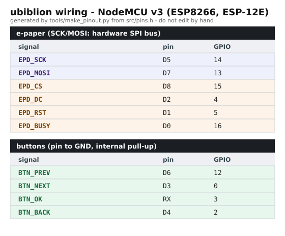

```
       _     _ _     _ _
      | |   (_) |   | (_)
 _   _| |__  _| |__ | |_  ___  _ __
| | | | '_ \| | '_ \| | |/ _ \| '_ \
| |_| | |_) | | |_) | | | (_) | | | |
| __,_|_.__/|_|_.__/|_|_|\___/|_| |_|
| | μ (mu, "micro") + βιβλίον (biblion, "book")
|_| a homemade ebook reader: ESP8266 / ESP32 + e-paper

```

A homemade ebook reader on an **e-paper display** (a WeAct Studio 1.54",
200x200, SSD1681) with four buttons. Books are uploaded over WiFi from the
browser or with `curl`, and stored on the internal flash. Note that code,
hostnames and passwords keep the ASCII spelling (`UBIBLION_*` flags,
`partitions_ubiblion.csv`, `ubiblion.local`) -- only the human-facing name
carries the μ.

It runs on two build targets: the original **ESP8266 (NodeMCU v3)** and an
**ESP32** (DevKitC / NodeMCU-32S with a WROOM-32, 4MB). Everything else --
the firmware logic, the web UI, the library format -- is identical; only the
pin map and a handful of core APIs differ (`src/compat.h` keeps both behind
one interface).

The trick behind the whole project: the ESP8266 doesn't have the RAM to decompress an EPUB (the
deflate window alone is 32KB, and there's only ~40KB of free heap here total), so **the EPUB gets
converted to plain text in the browser** during upload, using `DecompressionStream` and `DOMParser`,
both native. The device only ever handles UTF-8 text.

## Hardware

- An ESP8266 (NodeMCU v3) or an ESP32 (DevKitC / NodeMCU-32S, WROOM-32, 4MB)
- A [WeAct Studio 1.54" Black&White](https://github.com/WeActStudio/WeActStudio.EpaperModule)
  e-paper module (SSD1681)
- Four push buttons

| NodeMCU v3 | ESP32 DevKitC |
|---|---|
|  |  |

Before wiring the buttons:

- **ESP32:** each pin must read LOW at rest and HIGH when pressed.
- **ESP8266:** buttons connect to GND. Don't hold any down at reset, nor OK while uploading.

Board-specific details are in [Hardware](docs/hardware.md).

## Getting started

With [PlatformIO](https://platformio.org/), upload the firmware and then, once, the web UI (use
`nodemcuv2` instead of `esp32dev` for the ESP8266):

```bash
pio run -e esp32dev -t upload
pio run -e esp32dev -t uploadfs
```

> `uploadfs` rewrites **the entire** filesystem, including the books and `config.json`. Only use it
> when you change the web UI, and re-upload your books afterward. WiFi credentials do survive: they're
> also kept in EEPROM (in the NVS partition on ESP32), which lives outside LittleFS, and get restored
> automatically at boot.

### First boot

With no saved credentials, the device brings up an access point when WiFi is turned on:

1. Choose *Settings → WiFi: turn on* on the device (long-press **OK** while reading).
2. Connect to the `ubiblion` network with password `ubiblion`.
3. Open `http://192.168.4.1`, expand **Network settings** and enter your SSID and password.
4. Turn WiFi off and back on: it now joins your network and answers at `http://ubiblion.local`.

## Usage

| Button | Short press | Long press (>0.6s) |
|---|---|---|
| PREV | Previous page | 10 pages back |
| NEXT | Next page | 10 pages forward |
| OK | Library / select | Settings |
| BACK | Back | Screensaver (while reading or in the menus) |

In the library, **long OK** on a book asks for confirmation before deleting it, and the last row in
the list (*Settings…*) opens the configuration menu: font size, how often a full refresh happens,
WiFi, reindexing, and (when more than one is compiled in) the interface language.

### Adding books

With WiFi on, open the address shown on the reader and drop an `.epub` or `.txt` file on the page.
There's also a [console client and a REST API](docs/api.md).

### WiFi

WiFi is only on while its screen is showing: **BACK** leaves that screen and turns the radio off, so
it never runs in the background (it saves about 70mA and leaves more heap for rendering). Whether it
turns on by itself at boot is decided by the **wifiOnBoot** setting, configurable from the web:

| Value | Behavior |
|---|---|
| `0` | Never: only via the menu |
| `1` | Only if there are no books (default): handles the first boot, when the only useful thing to do is receive a book |
| `2` | Always: the sensible choice on a device with no buttons or one that's permanently plugged in |

Be careful leaving it at `1` if the buttons aren't wired up yet: as soon as there's a book, the reader
has no way left to turn the network on.

### Screensavers

Long-press **BACK** to show a picture; any button returns. To use up to four of your own, run this
and upload them from the window ([details](docs/screensavers.md)):

```bash
pip install pillow
python tools/screensaver_gui.py
```

### User manuals

Printable A4 user manuals are available in [English](docs/manuals/manual-ubiblion-en.pdf),
[Spanish](docs/manuals/manual-ubiblion-es.pdf), [French](docs/manuals/manual-ubiblion-fr.pdf),
[German](docs/manuals/manual-ubiblion-de.pdf), [Italian](docs/manuals/manual-ubiblion-it.pdf),
and [Catalan](docs/manuals/manual-ubiblion-ca.pdf).

## Status and limitations

- Formats: plain text on the device; EPUB converted in the browser or with the Python script. No
  images, footnotes, or table of contents.
- Battery: the ESP32 build sleeps between button presses; the ESP8266 one doesn't yet (see
  [Hardware](docs/hardware.md#power)).
- Maximum 40 books (`Library::MAX_BOOKS`).
- Converting EPUB in the browser needs `DecompressionStream`: Chrome/Edge 80+, Firefox 113+,
  Safari 16.4+. On older browsers the web UI only accepts `.txt`.

## Documentation

| Document | Contents |
|---|---|
| [Hardware](docs/hardware.md) | Board differences, flash layout, power, hardware testing |
| [Screensavers](docs/screensavers.md) | The image tool, formats and where your pictures live |
| [REST API](docs/api.md) | Endpoints and the console client |
| [Development](docs/development.md) | Build environments, development mode, languages, web UI, manuals |
| [Internals](docs/internals.md) | Code layout, pagination, display and memory |
