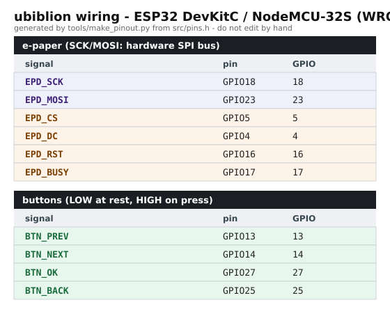

```
       _     _ _     _ _
      | |   (_) |   | (_)
 _   _| |__  _| |__ | |_  ___  _ __
| | | | '_ \| | '_ \| | |/ _ \| '_ \
| |_| | |_) | | |_) | | | (_) | | | |
| __,_|_.__/|_|_.__/|_|_|\___/|_| |_|
| | μ (mu, "micro") + βιβλίον (biblion, "book")
|_| a homemade ebook reader: ESP8266 / ESP32 + e-paper

```

A homemade ebook reader on an **e-paper display** (a WeAct Studio 1.54",
200x200, SSD1681) with four buttons. Books are uploaded over WiFi from the
browser or with `curl`, and stored on the internal flash. Note that code,
hostnames and passwords keep the ASCII spelling (`UBIBLION_*` flags,
`partitions_ubiblion.csv`, `ubiblion.local`) -- only the human-facing name
carries the μ.

It runs on two build targets: the original **ESP8266 (NodeMCU v3)** and an
**ESP32** (DevKitC / NodeMCU-32S with a WROOM-32, 4MB). Everything else --
the firmware logic, the web UI, the library format -- is identical; only the
pin map and a handful of core APIs differ (`src/compat.h` keeps both behind
one interface).

The trick behind the whole project: the ESP8266 doesn't have the RAM to decompress an EPUB (the
deflate window alone is 32KB, and there's only ~40KB of free heap here total), so **the EPUB gets
converted to plain text in the browser** during upload, using `DecompressionStream` and `DOMParser`,
both native. The device only ever handles UTF-8 text.

---

## Hardware

[WeAct Studio 1.54" Black&White](https://github.com/WeActStudio/WeActStudio.EpaperModule) module
(SSD1681 controller). Wiring matches the official ESP8266 example:

Both wiring charts are generated from `src/pins.h` by `tools/make_pinout.py`
(don't edit the SVGs by hand):

| NodeMCU v3 | ESP32 DevKitC |
|---|---|
|  |  |

### ESP8266 (NodeMCU v3)

- **GPIO0 (D3) and GPIO2 (D4) are boot-strapping pins** and must be high at reset. The internal
  pull-up keeps them there; it only fails if that button is held down during reset.
- **GPIO3 is RX**: the firmware opens the serial port in `SERIAL_TX_ONLY` mode to free it up, so logs
  still come out but nothing can be sent to the device over serial. Since esptool does transmit over
  RX while flashing, **don't hold OK down while uploading firmware**.
- For the same reason, `GxEPD2` is initialized with `epd.init(0, ...)`: a nonzero diagnostic bitrate
  would call `Serial.begin()` in full-duplex mode and steal GPIO3 right back.

`A0` is left free for measuring the battery once the build moves to LiPo.

### ESP32 (DevKitC / NodeMCU-32S, 4MB)

The firmware expects LOW at rest and HIGH on press. The button circuit must
hold each pin low when released because the firmware enables the internal pull-up.

Differences from the ESP8266 worth knowing:

- The serial port stays **full-duplex**: GPIO3 is not a button here, so nothing is ever stolen and
  logs work both ways.
- Build with the `esp32dev` or `dev_esp32` environments (see below); the flash
  is split by `partitions_ubiblion.csv` (1MB app + ~2.94MB LittleFS). The binary weighs ~950KB, so
  the app partition runs at ~90% — it fits, but if a future build outgrows 1MB, trim 256KB off the
  littlefs row in the CSV first.
- GPIO16/17 are used by the display: fine on the WROOM-32 dev kits, not on a WROVER (they're the
  PSRAM pins).
- GPIO12 is left free but straps the flash voltage at reset — keep a button on it *unpressed* at
  boot, or better, don't wire it. All the 34–39 input-only pins are free for the battery ADC (they
  have no internal pull-ups, so not for buttons).

---

## Building and flashing

With [PlatformIO](https://platformio.org/):

```bash
pio run -e nodemcuv2 -t upload   # ESP8266
pio run -e esp32dev -t upload    # ESP32
```

And then, once, the web UI (the contents of `data/`):

```bash
pio run -e esp32dev -t uploadfs   # or -e nodemcuv2
```

Always pass `-e`: without it PlatformIO runs every environment in turn. The other ones are the
development builds, `dev` and `dev_esp32` (see "Development mode"), and `nodemcuv2_en` (English only).

> `uploadfs` rewrites **the entire** filesystem, including the books and `config.json`. Only use it
> when you change the web UI, and re-upload your books afterward. WiFi credentials do survive: they're
> also kept in EEPROM (in the NVS partition on ESP32), which lives outside LittleFS, and get restored
> automatically at boot.

The 4MB flash is split into ~1MB of program and ~3MB of LittleFS on both targets -- via
`eagle.flash.4m3m.ld` on the ESP8266 and `partitions_ubiblion.csv` on the ESP32 -- see the comment
above `board_build.ldscript` in `platformio.ini` for why giving the filesystem the lion's share costs
nothing. That leaves room for a real library: a 300KB text file is around 600 pages, and the
unabridged *Don Quijote* (2.1MB of plain text, 11475 pages) uses well under half the free space.

Tested on real NodeMCU v3 hardware: display, LittleFS, WiFi, REST API, uploading books from a 227KB
sample up to the unabridged *Don Quijote* (2.1MB, 11475 pages), indexing, navigation and deletion. The
only thing still unverified on hardware is the four physical buttons, since they aren't wired up yet;
their logic has been exercised with development mode's virtual buttons.

Also brought up and verified on real ESP32 hardware (DevKitC, WROOM-32): the display through the new
pin map (splash, WiFi screen, full refreshes), the LittleFS partition, AP first boot and STA
connection, the REST API (status, library, upload with in-place EPUB-less text indexing of 300+ pages,
byte-exact book download), UTF-8 pagination with accents, and the development-mode screen mirror.
Version 1.0 is in use on that board with the four physical buttons wired, including light sleep between
presses.

Uploading a multi-megabyte book over WiFi to a single-core microcontroller genuinely takes a couple of
minutes end to end (transfer + writing to flash + indexing); the web UI's `fetch()` has no built-in
timeout so it just waits, but `tools/upload_book.py --timeout` defaults to 300s for the same reason --
raise it further for very large files on a slow network.

## Languages

Two independent, separately-configured translation systems, since they live in different places with
different constraints:

- **The reader's own screen** (menus, headers, footers) is compiled into the firmware binary, which
  has a tight flash budget. `src/i18n.h`/`i18n.cpp` hold one PROGMEM string table per language; which
  ones actually get compiled in is controlled by the `UBIBLION_LANG_EN/ES/FR/DE/IT/CA` flags in
  `platformio.ini` (all on by default). Compiling in all six costs a few KB of flash over an
  English-only build — cheap on this board's 4MB chip, but the flags exist to trim it down on tighter
  budgets. See `[env:nodemcuv2_en]` in `platformio.ini` for a worked single-language example. When more
  than one language is compiled in, a **Language** row shows up in the on-device Settings menu to
  cycle between them (persisted, same as every other setting); it's simply absent when only one is
  built in, since there'd be nothing to switch to.
- **The web UI** (`data/index.html`) lives in LittleFS, not in the firmware, so its flash budget is
  the spacious ~3MB filesystem partition, not the tight program one — six languages of UI labels there
  cost on the order of 18KB, negligible next to the books themselves. It defaults to the browser's own
  language (falling back to English) and can be switched from a selector at the top of the page,
  entirely independent of whatever the device's own screen is set to; the choice is remembered in
  `localStorage`. See "Web UI internals" below for how it's built and how to trim its language set too.

Adding a language to either system means adding one translated file (a `src/i18n.cpp` language block,
or a `data/i18n/<code>.json` file) with the same set of keys as an existing one — nothing else needs
to change.

## Development mode

```bash
pio run -e dev -t upload        # ESP8266
pio run -e dev_esp32 -t upload  # ESP32
```

The `dev`/`dev_esp32` environments compile the same firmware with
`-DUBIBLION_DEV=1` and add:

- **WiFi always on at boot**, ignoring `wifiOnBoot`. It's also the rescue path if a device becomes
  unreachable (with books loaded and no buttons, there's otherwise no way to turn the network back on).
- **Screen mirror**: `GET /api/debug/screen` returns the text that's painted on screen, with its
  coordinates. Lets you see what the e-ink display shows without having it in front of you.
- **Virtual buttons**: `POST /api/debug/press?button=PREV|NEXT|OK|BACK&long=0|1` injects a press.
  Useful for driving the whole device from the browser before wiring up the real buttons.
- **Button log**: `GET /api/debug/input` lists the latest events, distinguishing real presses from
  injected ones, which is how you check the wiring without watching the serial port.
- **Page inspector**: `GET /api/debug/page?id=b0001&page=7` returns that page's lines with their pixel
  width, exactly as the reader computes them.

The web UI detects the `dev` firmware from the `dev` field in `/api/status` and shows a panel with all
of the above. None of these endpoints exist in the normal build.

## First boot

With no saved credentials, the device brings up an access point when WiFi is turned on:

1. Long-press **BACK** (or *Settings → WiFi: turn on*) on the device.
2. Connect to the `ubiblion` network with password `ubiblion`.
3. Open `http://192.168.4.1`, expand **Network settings** and enter your SSID and password.
4. Turn WiFi off and back on: it now joins your network and answers at `http://ubiblion.local`.

---

## Usage

Printable A4 user manuals are available in [English](docs/manuals/manual-ubiblion-en.pdf),
[Spanish](docs/manuals/manual-ubiblion-es.pdf), [French](docs/manuals/manual-ubiblion-fr.pdf),
[German](docs/manuals/manual-ubiblion-de.pdf), [Italian](docs/manuals/manual-ubiblion-it.pdf),
and [Catalan](docs/manuals/manual-ubiblion-ca.pdf).

| Button | Short press | Long press (>0.6s) |
|---|---|---|
| PREV | Previous page | 10 pages back |
| NEXT | Next page | 10 pages forward |
| OK | Library / select | Settings |
| BACK | Back | Turn WiFi on or off (while reading or in the library) |

In the library, **long OK** on a book asks for confirmation before deleting it, and the last row in
the list (*Settings…*) opens the configuration menu: font size, how often a full refresh happens,
WiFi, reindexing, and (when more than one is compiled in) the interface language.

WiFi is only on while its screen is showing: **BACK** leaves that screen and turns the radio off, so
it never runs in the background (it saves about 70mA and leaves more heap for rendering). Development
builds are the exception: there **OK** leaves the screen with WiFi still on. Whether it turns on
by itself at boot is decided by the **wifiOnBoot** setting, configurable from the web:

| Value | Behavior |
|---|---|
| `0` | Never: only via the button or the menu |
| `1` | Only if there are no books (default): handles the first boot, when the only useful thing to do is receive a book |
| `2` | Always: the sensible choice on a device with no buttons or one that's permanently plugged in |

Be careful leaving it at `1` if the buttons aren't wired up yet: as soon as there's a book, the reader
has no way left to turn the network on.

---

## REST API

Every endpoint returns JSON. If `config.json` sets `apiKey`, it has to be sent in the `X-Api-Key`
header; otherwise the API is open on the local network.

| Method | Route | What it does |
|---|---|---|
| `GET` | `/` | Web UI |
| `GET` | `/api/status` | Version, heap, free space, indexing state |
| `GET` | `/api/library` | List of books |
| `POST` | `/api/books?title=…&author=…` | Uploads a `.txt` (`multipart/form-data`, `file` field) |
| `GET` | `/api/books/{id}` | Downloads the text |
| `DELETE` | `/api/books/{id}` | Deletes the book and its index |
| `POST` | `/api/books/{id}/open?page=N` | Marks it as the current book |
| `POST` | `/api/books/{id}/reindex` | Rebuilds the page index |
| `GET` `POST` | `/api/config` | Reads or saves SSID, password, hostname, API key, `wifiOnBoot`, `lang`… |
| `POST` | `/api/system/reboot` | Restarts |

An upload responds `202` as soon as the file is on flash; indexing continues in the background and its
progress can be checked at `/api/status`.

```bash
curl -F "file=@moby-dick.txt" "http://ubiblion.local/api/books?title=Moby%20Dick"
curl -s http://ubiblion.local/api/library | jq
```

### Console client

`tools/upload_book.py` does the same thing as the web UI (EPUB conversion included) with no
dependencies beyond Python's standard library:

```bash
python tools/upload_book.py book.epub
```

```bash
python tools/upload_book.py --list
```

---

## How it works inside

```
src/
  pins.h        pin assignments (one conditional block per target)
  compat.h      the only place that knows which core it's on (ESP8266/ESP32)
  display.*     GxEPD2 + U8g2 (UTF-8), partial/full refresh policy
  i18n.*        on-device UI strings, up to six languages (PROGMEM tables)
  input.*       4 buttons, 25ms debouncing, long press
  library.*     books on LittleFS: .txt + .idx + .json
  paginator.*   line wrapping and the page index
  reader.*      reading screen and deferred progress save
  menu.*        library, settings and delete confirmation
  power.*       CPU frequency and light sleep between presses (ESP32)
  webserver.cpp WiFi on demand, REST API and the web UI
  webui.h       (kept out of webserver.h: on Windows/NTFS -Isrc would shadow
                the ESP32 core's own WebServer.h header)
  main.cpp      state machine
data/
  index.template.html  web UI source: HTML/CSS/JS with data-i18n hooks
  i18n/*.json          one translation file per language
  index.html           generated by tools/build_web.py -- not edited directly
tools/          console client, layout tests, web build, pinout charts, manuals
partitions_ubiblion.csv  ESP32 flash split (1MB app + ~2.94MB LittleFS)
docs/           pinout SVGs (make_pinout.py) and user manuals (tools/manual/)
```

Everything targets whatever core runs it through `compat.h`; modules like
`paginator`, `reader`, `menu` or `i18n` never branch on the chip. Where the
cores genuinely differ (WebServer/mDNS classes, radio power mgmt, FS
directory walking, serial RX pin) the divergence is absorbed in `compat.h`
and `library.cpp`'s two `#ifdef` blocks.

**Pagination.** Over plain text you can't go back a page without recomputing the line wrap from
scratch, so adding a book builds `/books/<id>.idx`: an 8-byte header followed by the starting offset
of every page as a `uint32`. Jumping to page N becomes a direct read. The computation is incremental
(about 20ms per spin of `loop()`) so it doesn't trip the watchdog, and a progress bar shows while it
runs.

Line wrapping lives in a single function (`layout()` in `paginator.cpp`) shared by indexing and
rendering, so the two can never disagree. The layout version (font, usable width, lines per page) is
stored in both the `.idx` and the `.json`, so changing the font size invalidates the indexes and they
rebuild themselves.

`tools/test_layout.py` is a Python port of that algorithm that checks its invariants without needing
hardware: that offsets always increase, that the boundary computed while indexing matches the one
rendering produces, that no line exceeds the usable width, that text is preserved character for
character, and that **the line breaks match a reference greedy wrapper**. That last check wasn't there
at first, and that's how a bug that split a single word across every line made it onto the board: it
lost no text and never exceeded the width, so the other invariants gave it a pass while it quadrupled
the page count. It tests the algorithm, not the compiled binary; if you touch `layout()`, mirror the
change there and run it:

```bash
python tools/test_layout.py
```

**Progress.** The current page is saved after 10 seconds of inactivity, not on every page turn:
writing to flash 600 times per book would wear it out.

**Refresh.** Every page change is a partial refresh; every N (10 by default) a full one is forced to
clear the SSD1681's ghosting.

**Highlighted rows (white text on black).** `U8g2_for_Adafruit_GFX` decodes glyphs incorrectly as soon
as the foreground color stops being `0` (black): with white, or even a plain `1`, it paints shapeless
rectangular blocks instead of letters. Confirmed on real hardware with a diagnostic pattern that
compared, with the same text, u8g2 in black (perfect), u8g2 in white (broken), u8g2 with `color=1`
(equally broken), and Adafruit_GFX's own font in white (perfect) — so the bug is specific to u8g2's
glyph decoder in transparent mode with a non-zero ink color, not the panel, the wiring, or the color
itself. No official GxEPD2 example ever uses white on black with u8g2, which fits a real, little-known
limitation better than a usage mistake.

`Display::textInverted()` (`display.cpp`) works around it: it renders the text in **black** — the only
path u8g2 decodes correctly — onto an auxiliary `GFXcanvas1` in RAM, then blits those pixels inverted
by hand onto the real screen with `drawPixel()`, which is reliable with any color since it never goes
through u8g2's decoder. Full accent and UTF-8 support is kept on highlighted menu rows.

**Memory.** The full framebuffer (200x200/8 = 5000 bytes) is kept in RAM: that's what allows using
`display(partial)` and `displayWindow()` without repainting in bands. With that, the firmware's static
data adds up to about 6.4KB, leaving plenty of heap for the web server and rendering strings.

### User manuals

The PDFs in `docs/manuals/` are generated, one per language, from `tools/manual/`:

```bash
pip install reportlab svglib
python tools/manual/build.py
```

The layout and the Spanish text live in `generate.py`, the other languages in `translations.txt`. The
script uses the Arial fonts shipped with Windows.

### Web UI internals

`data/index.html` — the file actually served by the device and uploaded by `pio run -t uploadfs` — is
**generated**, not edited directly. The maintained source is `data/index.template.html` (all the
HTML/CSS/JS, with `data-i18n="key"` attributes on translatable elements and `t("key", vars)` calls in
the JavaScript) plus `data/i18n/<code>.json`, one flat key→string dictionary per language.

`tools/build_web.py` bundles the selected languages' JSON into the template's `%%I18N_JSON%%`
placeholder and writes `data/index.html`. PlatformIO runs it automatically before every build (see
`extra_scripts` in `platformio.ini`), so `pio run -t uploadfs` always uploads a fresh file — there's
no separate step to remember. Which languages get bundled is controlled by the `UBIBLION_WEB_LANGS`
environment variable, a comma-separated list of codes (default: every file found in `data/i18n/`):

```bash
UBIBLION_WEB_LANGS=en,es pio run -t uploadfs
```

Trimming it down keeps the unused languages' strings out of the LittleFS image; on this project that's
only a few KB per language, so it mostly matters if you're already tight on filesystem space for other
reasons. The page picks its own language independently at runtime (browser language, overridable from
a selector, remembered in `localStorage`) — that's separate from which languages were baked in at
build time, and separate from the device's own on-screen menu language (see "Languages" above).

---

## Status and limitations

- Formats: plain text on the device; EPUB converted in the browser or with the Python script. No
  images, footnotes, or table of contents.
- Power: the ESP32 build runs at 80MHz and light-sleeps between button presses whenever WiFi is
  off and no book is being indexed. WiFi stays on (and the chip awake) while its screen is open. On a
  dev board the regulator, USB-UART chip and power LED keep drawing current while the chip sleeps,
  which limits battery life.
- The ESP8266 build doesn't sleep yet: light sleep with a GPIO wakeup fits the four buttons, while
  deep sleep would need GPIO16 wired to RST, and that's where BUSY currently is.
- Maximum 40 books (`Library::MAX_BOOKS`).
- Converting EPUB in the browser needs `DecompressionStream`: Chrome/Edge 80+, Firefox 113+,
  Safari 16.4+. On older browsers the web UI only accepts `.txt`.
